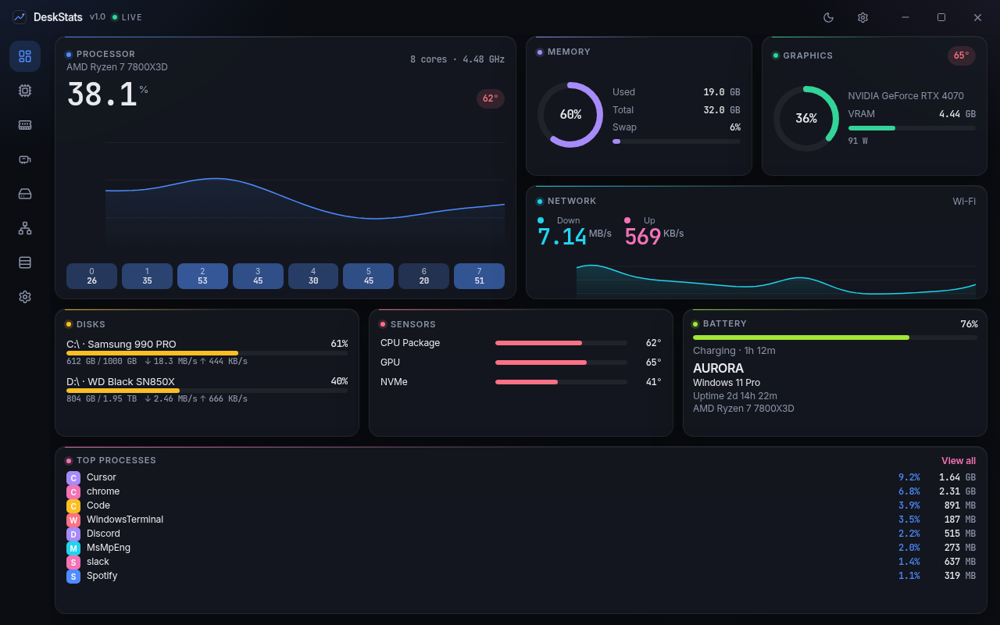
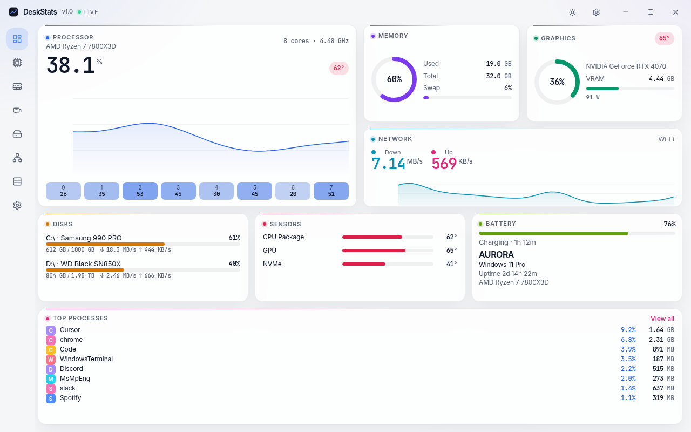
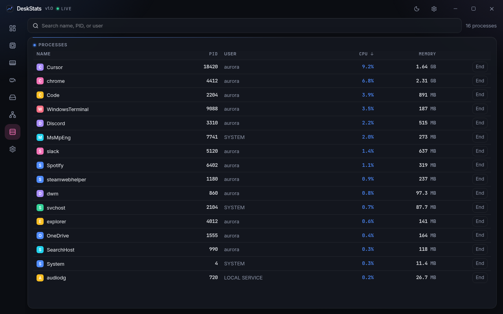
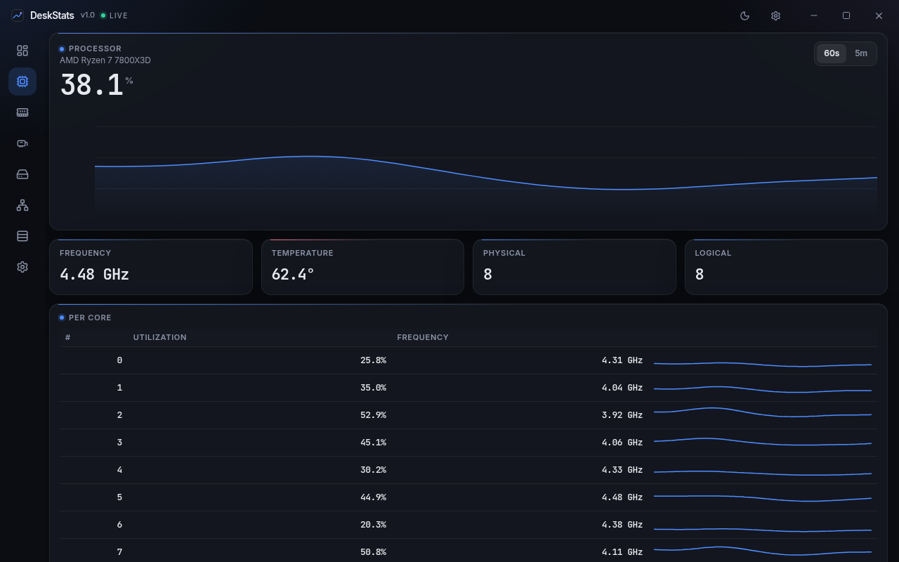
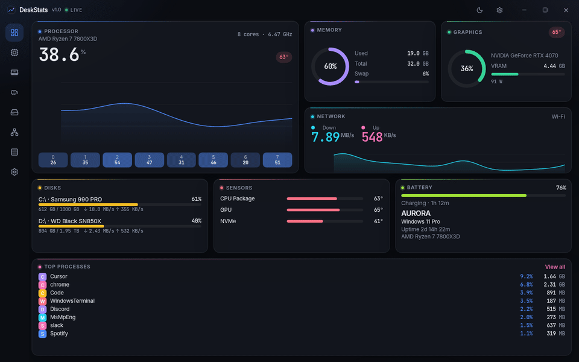

# DeskStats

A calm, dense system monitor. Aurora Bento on Tauri: graphite cards, one color per metric, tabular numbers, and thin live charts.

<p align="center">
  
</p>

English · [中文](README.zh-CN.md)

## Screenshots

The pictures below are the built-in demo dashboard (1280×800), so they stay reproducible in CI and in a browser.

| Dark | Light |
| --- | --- |
|  |  |

| Processes | CPU detail |
| --- | --- |
|  |  |

<p align="center">
  
</p>

## Features

- Overview bento: CPU (total, per-core heat, 60s history), memory and swap, GPU, disks, network up/down, battery, temperatures, host and uptime.
- Process list with search, sort, and end-process confirmation.
- Detail pages for CPU, memory, GPU, disks, and network (60s or 5 min).
- Dark, light, and system themes. English and Simplified Chinese, following the OS language until you switch.
- Windows 11 Mica, macOS vibrancy, solid graphite on Linux.
- Sampling interval 0.5 / 1 / 2 / 5 seconds. Hidden or minimized windows sample at 4× (at least 2s).
- Tray icon: show, pause, quit, and a CPU / RAM tooltip.
- Optional NVIDIA readings through NVML (`nvidia` feature, on by default). If the driver library is missing, GPU data falls back to `sysinfo` and temperatures stay blank.
- Demo mode for screenshots and headless runs.

## Install

Release tags build installers with GitHub Actions:

| Platform | Artifacts |
| --- | --- |
| Windows | `.msi`, NSIS `.exe` |
| macOS | `.dmg` |
| Linux | `.deb`, `.AppImage` |

### Unsigned installers

v1 builds are **not code-signed**.

- Windows SmartScreen may say the publisher is unknown. Choose “More info” → “Run anyway”, or install with the MSI after you trust the file.
- macOS Gatekeeper may block the app. Open System Settings → Privacy & Security and allow DeskStats, or right-click the app and choose Open the first time.
- Linux package managers may ask you to confirm a local package that is not from a distro repository.

### Windows temperatures

Windows has no standard CPU temperature API. DeskStats shows a reading when the operating system already exposes one (and NVIDIA GPU temperature through NVML, which does not need an extra kernel driver). Otherwise the card shows an em dash. v1 does **not** bundle an admin driver. Deeper sensors are planned as an explicit opt-in.

## Build

Requirements: Node.js 22, Rust stable (1.95+), and the platform WebView dependencies ([Tauri prerequisites](https://v2.tauri.app/start/prerequisites/)).

```bash
npm ci
npm run tauri dev
```

Production bundles:

```bash
npm run tauri build
```

Outputs land in `src-tauri/target/release/bundle/`.

### Demo mode

The interface runs in a browser with scripted data when it is not inside Tauri. That is what the README screenshots use.

```bash
npm run dev
# http://127.0.0.1:1420
```

Force demo data inside the desktop shell:

```bash
# either flag
npm run tauri dev -- --demo

# or environment variable
DESKSTATS_DEMO=1 npm run tauri dev
```

Screenshot query parameters: `shot=1`, `theme=dark|light`, `lang=en|zh`, `page=overview|cpu|memory|gpu|disk|network|processes|settings`.

### Tests

```bash
npm test          # frontend
npm run lint
cargo test --manifest-path src-tauri/Cargo.toml
```

## Stack

Tauri 2, React 19, TypeScript, Vite, Tailwind CSS 4, uPlot, and Rust (`sysinfo`, `starship-battery`, optional `nvml-wrapper`). UI text is Inter; numbers are JetBrains Mono. Motion follows `prefers-reduced-motion` and a setting.

Linux note: some Wayland sessions need `WEBKIT_DISABLE_DMABUF_RENDERER=1`. The tray icon needs an AppIndicator host; GNOME hides the tray unless an extension provides one.

## Roadmap

- **v1.1 Alerts.** Thresholds for CPU, memory, temperature, disk space, and low battery, with a hold time and cooldown before a notification fires.
- **v1.2 Widget mode.** Pop any card into a borderless, always-on-top window. Drag, lock, and fade it. Tray mini-panel.
- **v1.3 Deeper sensors.** Optional LibreHardwareMonitor (PawnIO) sidecar on Windows for CPU temperature, fans, voltage, and power, with a clear administrator prompt. macOS SMC temperatures and fans.
- **v1.4 History.** Local SQLite for 24h / 7d charts and CSV export.
- **v1.5 Layouts and themes.** Presets (Catppuccin, Nord, Dracula), custom accents, and a draggable card layout.

Later: launch at login, updates, menu-bar speeds, opt-in LAN viewing, and pluggable sources.

## License

[MIT](LICENSE)
