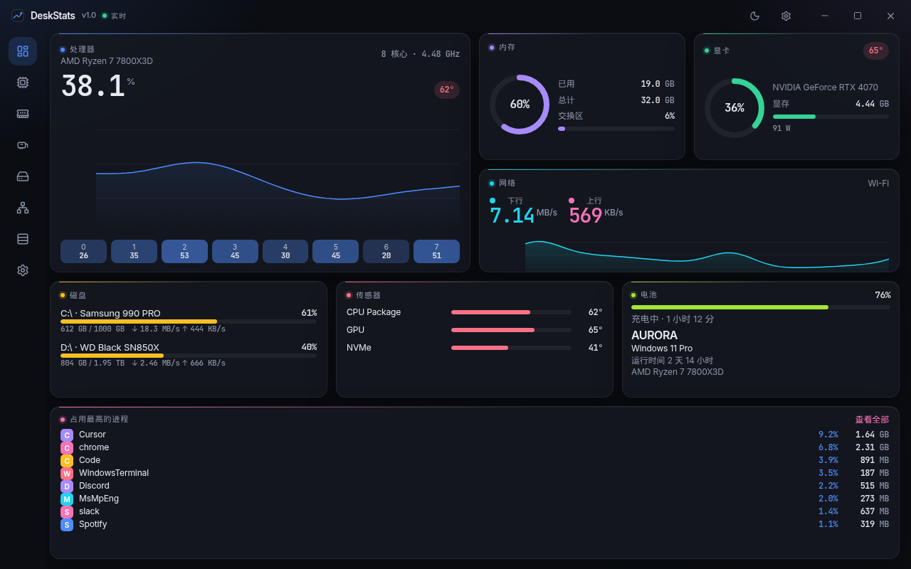
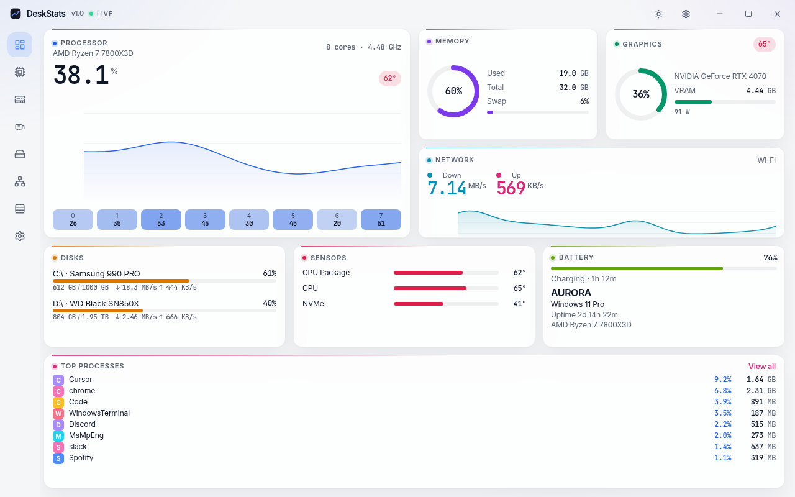
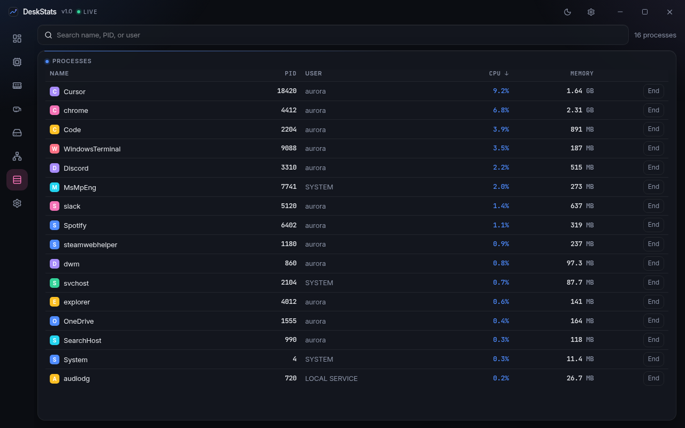
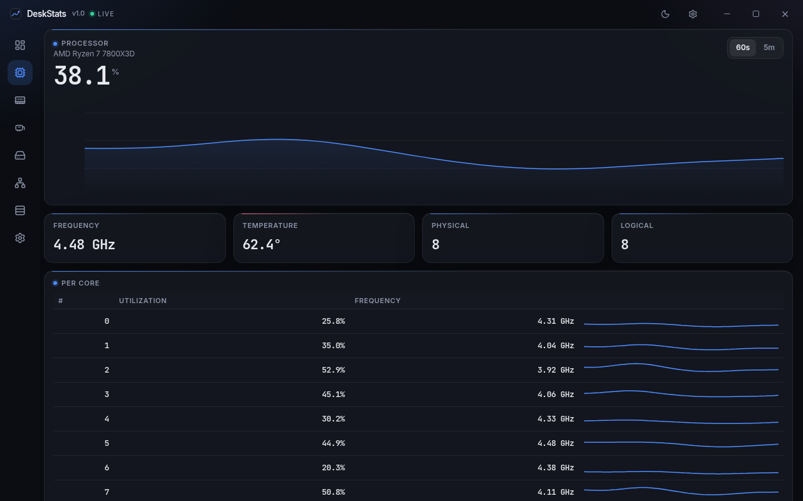
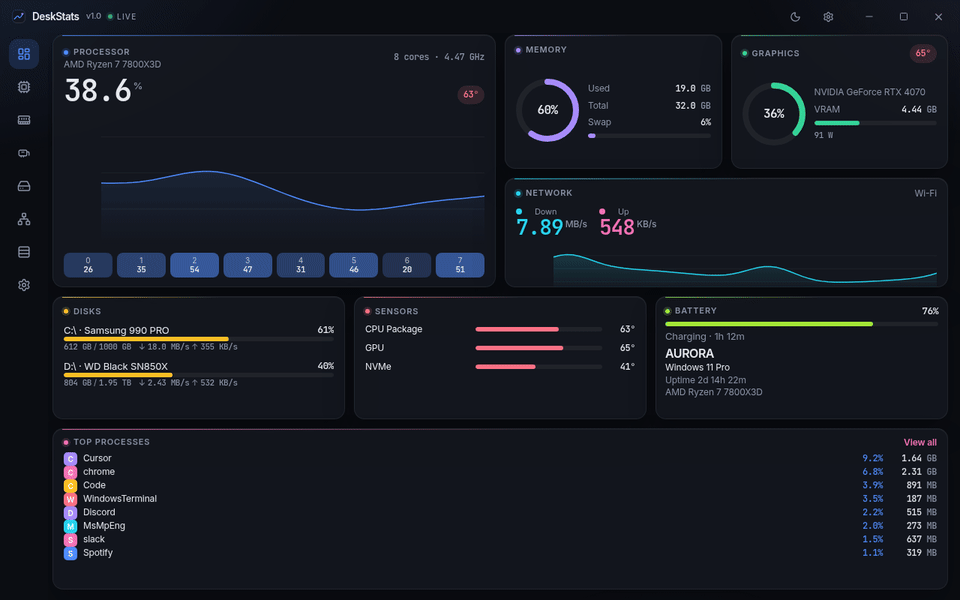

# DeskStats

一台忙碌电脑的从容视图。Aurora Bento 风格：石墨色卡片、每个指标一种颜色、等宽数字、细线实时曲线。

<p align="center">
  
</p>

[English](README.md) · 中文

## 截图

下面的图来自内置演示数据（窗口 1280×800），因此在浏览器和 CI 里都能复现。

| 深色 | 浅色 |
| --- | --- |
|  |  |

| 进程 | 处理器详情 |
| --- | --- |
|  |  |

<p align="center">
  
</p>

## 功能

- 总览 bento：CPU（总占用、每核心热力、60 秒曲线）、内存与交换区、显卡、磁盘、网络上下行、电池、温度、主机与运行时间。
- 进程页：搜索、排序、结束进程前二次确认。
- CPU、内存、显卡、磁盘、网络详情页（60 秒或 5 分钟）。
- 深色、浅色、跟随系统。界面语言跟随系统，可在设置里切换英文和简体中文。
- Windows 11 使用 Mica，macOS 使用振动模糊（vibrancy），Linux 回退为纯色石墨底。
- 采样间隔 0.5 / 1 / 2 / 5 秒。窗口隐藏或最小化时降为 4 倍（至少 2 秒）。
- 托盘：显示、暂停、退出，提示里带 CPU / 内存。
- NVIDIA 读数走 NVML（默认开启的 `nvidia` 特性）。驱动库不存在时自动退回 `sysinfo`，温度留空，不会报错退出。
- 演示模式，方便截图和无界面环境。

## 安装

打上版本标签后，GitHub Actions 会构建安装包：

| 平台 | 产物 |
| --- | --- |
| Windows | `.msi`、NSIS `.exe` |
| macOS | `.dmg` |
| Linux | `.deb`、`.AppImage` |

### 未签名安装包

v1 **没有代码签名**。

- Windows SmartScreen 可能提示发布者未知。选择「更多信息」→「仍要运行」，或在确认文件来源后安装 MSI。
- macOS Gatekeeper 可能拦截。到「系统设置 → 隐私与安全性」中允许 DeskStats，或第一次右键点「打开」。
- Linux 从本地安装未进入发行版仓库的包时，包管理器会要求确认。

### Windows 温度

Windows 没有标准的 CPU 温度接口。系统已经暴露读数时 DeskStats 会显示；NVIDIA 显卡温度通过 NVML 读取，不需要额外内核驱动。读不到就显示破折号。v1 **不会**打包需要管理员权限的驱动。深度传感器计划做成明确授权后才开启的可选项。

## 从源码构建

需要 Node.js 22、Rust stable（1.95+），以及对应平台的 WebView 依赖（见 [Tauri 前置要求](https://v2.tauri.app/start/prerequisites/)）。

```bash
npm ci
npm run tauri dev
```

打包：

```bash
npm run tauri build
```

产物在 `src-tauri/target/release/bundle/`。

### 演示模式

不在 Tauri 里打开时，界面使用脚本生成的数据。README 截图就是这样来的。

```bash
npm run dev
# http://127.0.0.1:1420
```

在桌面壳里强制演示数据：

```bash
npm run tauri dev -- --demo
# 或
DESKSTATS_DEMO=1 npm run tauri dev
```

截图可用查询参数：`shot=1`、`theme=dark|light`、`lang=en|zh`、`page=overview|cpu|memory|gpu|disk|network|processes|settings`。

### 测试

```bash
npm test
npm run lint
cargo test --manifest-path src-tauri/Cargo.toml
```

## 技术栈

Tauri 2、React 19、TypeScript、Vite、Tailwind CSS 4、uPlot，Rust 侧使用 `sysinfo`、`starship-battery`，以及可选的 `nvml-wrapper`。界面字体是 Inter，数字是 JetBrains Mono。动效遵守 `prefers-reduced-motion`，也可以在设置里关掉。

Linux：部分 Wayland 环境需要 `WEBKIT_DISABLE_DMABUF_RENDERER=1`。托盘依赖 AppIndicator，GNOME 默认不显示托盘，除非安装了相应扩展。

## 路线图

- **v1.1 通知 / 告警。** CPU、内存、温度、磁盘空间和低电量阈值。持续一段时间才触发，并带冷却时间。
- **v1.2 小组件模式。** 任意卡片弹出为无边框置顶小窗，可拖拽、锁定、调节透明度。托盘迷你面板。
- **v1.3 深度传感器。** Windows 上可选的 LibreHardwareMonitor（PawnIO）边车进程，读取 CPU 温度、风扇、电压和功耗，并明确提示需要管理员。macOS 读取 SMC 温度和风扇。
- **v1.4 历史与导出。** 本地 SQLite 保存 24 小时 / 7 天曲线，支持 CSV 导出。
- **v1.5 主题与布局。** Catppuccin、Nord、Dracula 等预设、自定义强调色，以及可拖拽保存的卡片布局。

之后：开机启动、自动更新、菜单栏实时速率、默认关闭的局域网查看，以及可插拔数据源。

## 许可证

[MIT](LICENSE)
